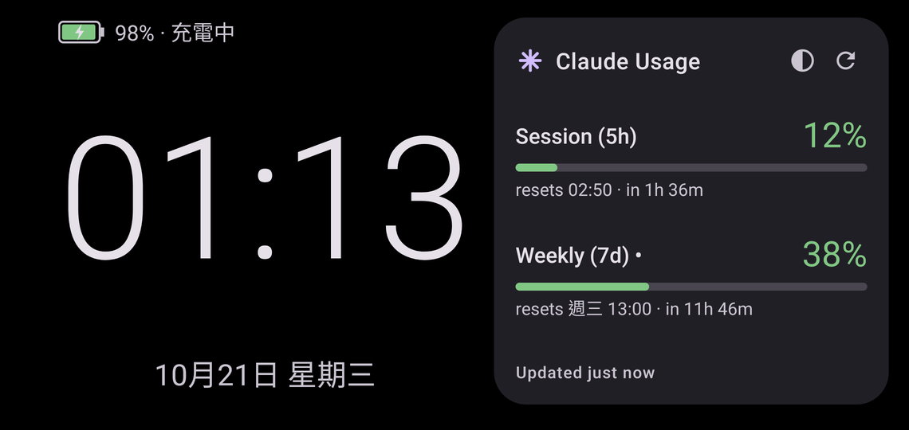

# Claude Usage (Android)

Your Claude subscription usage on the home screen and in the status bar.
An Android port of the ideas in
[plasma-claude-usage](https://github.com/gdevenyi/plasma-claude-usage).

> **This is a fork** of [gdevenyi/android-claude-usage](https://github.com/gdevenyi/android-claude-usage).
> It adds:
>
> - **Android 10+** — upstream needs Android 13. Below 13 there is no
>   notification permission to ask for; below 12 the notification's bars keep
>   the default tint (the percentages are still colour coded).
> - **Clock mode** — an always-on screen for a spare phone: a large clock, the
>   date and the battery level beside the widget's full layout. See
>   [Clock mode](#clock-mode).
>
> It keeps upstream's application id, so it installs over (and can't sit
> beside) the upstream app. Everything else is upstream's work; the changes
> are in the commits after upstream's `master`.

## 中文說明

在 Android 桌面小工具和通知列顯示 Claude 訂閱方案的使用量：5 小時 session、7 天
weekly 的百分比、重置倒數，以及各模型的用量。這個版本改自
[gdevenyi/android-claude-usage](https://github.com/gdevenyi/android-claude-usage)，
另外加了：

- **支援 Android 10 以上**（原版要 Android 13）。
- **時鐘模式**：適合拿閒置的舊手機插著充電，當成常駐的桌面時鐘。橫向全螢幕、螢幕常亮，
  左邊是大字時鐘、日期和電量（充電時顯示「充電中」），右邊是和小工具一樣的使用量面板。
  半圓按鈕切換主題（跟隨系統／深色／淺色），長按面板回到 app。從桌面的
  **Usage Clock** 圖示，或 app 裡的 **Clock mode** 按鈕開啟。

**安裝**：到 [Releases](https://github.com/killbeezero/android-claude-usage/releases/latest)
下載 APK 安裝。裝過原版的話要先解除安裝，因為簽章不同。

**登入**：打開 app 按 **Log in with Claude**，在瀏覽器授權後，把畫面上的代碼貼回 app。
app 自己保存登入憑證，不會讀取或影響電腦上的 Claude Code。

介面是英文的，只有時鐘模式的電量文字有中文。授權沿用原專案的 GPL-3.0。

- **Home-screen widget** — session (5h) and weekly (7d) percentages, colour
  coded, with progress bars, reset countdowns and the per-model breakdown.
  It scales with the size you give it, from a 2×1 chip to a full panel.
- **Ongoing notification** — the same numbers in the shade; expand for the
  full breakdown.
- **History and forecast** — the app charts the current session (5 h) and
  weekly (7 d) quota windows from start to reset, with the trend extended as
  a dashed line racing the reset, plus a 3-week history of total and
  per-model quota. When a
  trend reaches 100% before the window resets, the widget and notification
  add a warning ("out ~13:10"). History lives only on the device and is
  deleted on logout.
- Tap the widget or the notification to open the app (which also refreshes).
  The notification's **Refresh** button and the widget's ↻ icon refresh in
  place. Otherwise it updates every 15 minutes in the background.

## Screenshots

The widget shows everything at four rows — both windows with reset times, the
per-model breakdown and your plan:


Give it less room and it drops content rather than clipping it: the reset
times go first, then the labels.


The notification carries the same numbers, collapsed and expanded:


Clock mode, in its dark theme:



The app holds the settings and the history charts:


## Requirements

Android 10 or later, and a Claude subscription (Pro or Max).

## Install

Download the APK from the latest
[release](https://github.com/killbeezero/android-claude-usage/releases/latest).
Untagged commits build one too: open the run under
[Actions](https://github.com/killbeezero/android-claude-usage/actions) and
download the `apk` artifact (you need to be signed in to GitHub).

> This fork signs debug APKs with a fixed key kept in the repository
> (`app/debug.keystore`, the standard `android` / `androiddebugkey`
> credentials), so newer builds install over older ones. It is a debug key,
> not a secret: anyone can sign with it. Switching from an upstream build
> means uninstalling first, since that one is signed differently.

Or build it yourself:

```bash
./gradlew :app:assembleDebug
adb install -r app/build/outputs/apk/debug/app-debug.apk
```

You need the Android SDK; point `local.properties` at it with
`sdk.dir=/path/to/Android/Sdk`.

### Signing releases in CI

Gradle leaves the release APK unsigned, and Android will not install it. To
have CI sign it, create a keystore once and add four repository secrets:

```bash
keytool -genkey -v -keystore release.jks -alias claude-usage \
  -keyalg RSA -keysize 2048 -validity 10000
base64 -w0 release.jks   # paste as the KEYSTORE_BASE64 secret
```

`KEYSTORE_BASE64`, `KEYSTORE_PASSWORD`, `KEY_ALIAS`, `KEY_PASSWORD`. Keep the
keystore file itself out of the repository — losing it means future releases
can no longer upgrade installs of the old one. F-Droid does not need any of
this; it signs with its own key.

## Logging in

Open the app and tap **Log in with Claude**. Your browser opens Claude's
authorization page; approve it, copy the code it shows you, and paste it back
into the app.

The app logs in on its own and holds its own credentials. It does not read,
copy or need the credentials from Claude Code on your computer — and logging
in here does not disturb any of your other Claude Code sessions.

## How it works

The app performs the OAuth PKCE flow that Claude Code uses, then polls
`https://api.anthropic.com/api/oauth/usage` with its own access token,
refreshing that token itself as needed. Nothing is sent anywhere else, and
the tokens stay in the app's private storage.

This uses an OAuth flow that Anthropic has not documented for third parties.
It works today; it could stop working if Anthropic changes it.

One quirk inherited from that flow: the PKCE verifier travels in the `state`
parameter of the authorization URL, so it ends up in your browser history.
That only matters for a login you start and abandon — anything able to read
your browser history could finish it while the code is still valid. Completing
(or simply redoing) the login makes the code useless.

## Clock mode

Meant for an old phone left on its charger. Open it from its own launcher
icon, **Usage Clock**, or from **Clock mode** in the app.

- Landscape and full screen, and the screen stays on for as long as it is
  showing — whatever the system's screen timeout says.
- A large clock (12/24 h follows the system) and the date in the system
  language, beside the widget's full layout: both windows with reset times,
  the per-model rows and the last update.
- The battery level in the top-left corner, with a bolt and "Charging" on the
  charger and red below 15%.
- The half-circle button cycles the theme: follow system, dark (on pure
  black), light. The ↻ button refreshes.
- Everything shifts a few pixels each minute, against burn-in.
- Long-press the usage panel to get back to the app; a stray tap does nothing.

Text is sized independently of the system font size, so the layout fits a
small screen even with large fonts.

## Settings

Log in / log out, turn the ongoing notification on or off, and choose the
refresh interval (15, 30 or 60 minutes — 15 is the shortest Android's
background scheduler allows).

## Support

If this is useful to you:

<a href="https://buymeacoffee.com/gdevenyi"></a>

## License

GPL-3.0-or-later.
